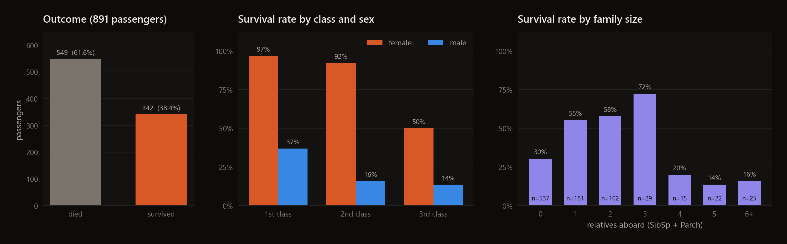
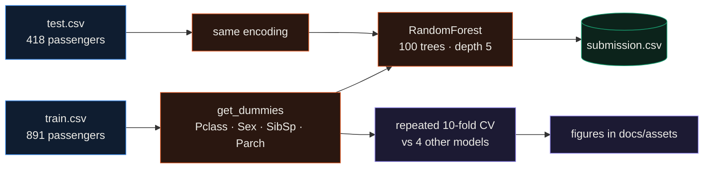
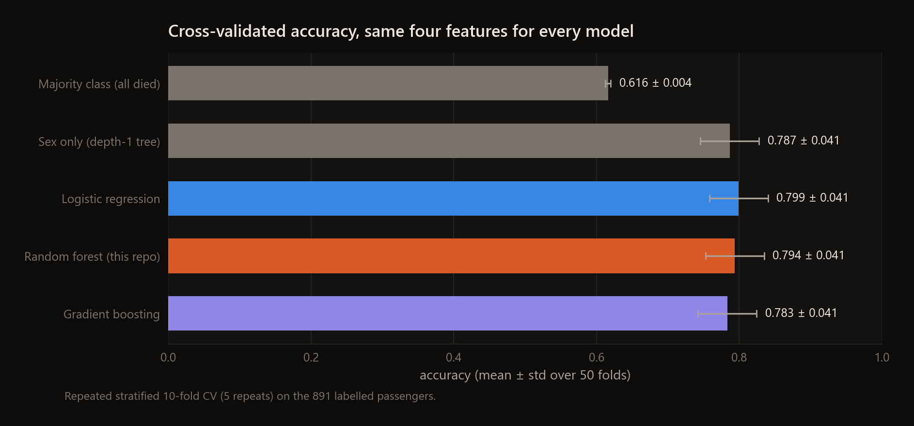
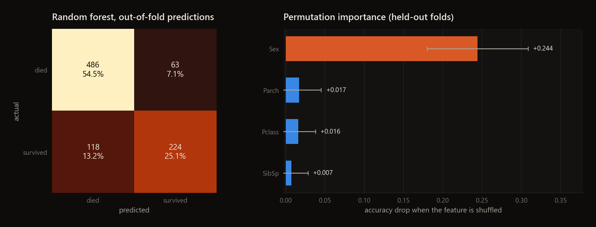

<div align="center">

# Titanic Survival Prediction

**A four-feature random forest for Kaggle's Titanic competition, cross-validated against simple baselines.**




</div>

This is my entry for Kaggle's [Titanic competition](https://www.kaggle.com/c/titanic). The model is deliberately
small: a random forest (100 trees, max depth 5) on passenger class, sex and the two family-size columns, one-hot
encoded with `get_dummies`. Its submission scored 0.77511 on the public leaderboard. I then added a
cross-validation script to see how much of that comes from the forest and how much from the fact that most women
survived and most men did not.

## Highlights

- The forest reaches 0.794 ± 0.041 cross-validated accuracy, against 0.616 for predicting that everyone died.
- A single split on sex already gets 0.787. Logistic regression and gradient boosting on the same features land within one standard deviation (0.799 and 0.783).
- Shuffling `Sex` on held-out folds costs the forest 0.244 accuracy. Shuffling any other feature costs less than 0.02.
- With four discrete features the 891 passengers collapse into 74 distinct profiles, and the forest's out-of-fold predictions agree with "women survive, men die" for 95.2% of passengers.
- The same forest with Age, Fare, Embarked and the title from `Name` added reaches 0.830 ± 0.039, so the remaining headroom is in features, not in model choice.

---

## How it works



`Titanic-Survival-Prediction.py` trains on all 891 labelled passengers and writes `submission.csv` for the 418 test
passengers. `scripts/make_figures.py` runs the evaluation below and draws the figures.

## Results

Every model uses the same four features and is scored with repeated stratified 10-fold cross-validation (5 repeats,
50 folds) on the 891 labelled passengers, since Kaggle keeps the test labels hidden.

| model | CV accuracy |
|---|---|
| Majority class (everyone died) | 0.616 ± 0.004 |
| Sex only (depth-1 tree) | 0.787 ± 0.041 |
| Logistic regression | 0.799 ± 0.041 |
| Random forest (this repo) | **0.794 ± 0.041** |
| Gradient boosting | 0.783 ± 0.041 |





Out of fold, the forest finds 224 of the 342 survivors (recall 0.655, precision 0.781). Its mistakes follow the sex
rule it mostly learned: 107 of the 118 missed survivors are men, and 48 of the 63 false alarms are third-class women,
the one group where survival was a coin flip (50%). Training accuracy is 0.816, close to the CV score, so a depth-5
forest is not overfitting here.

## Quickstart

```bash
git clone https://github.com/EllE961/Titanic-Survival-Prediction.git
cd Titanic-Survival-Prediction
pip install -r requirements.txt
python Titanic-Survival-Prediction.py   # writes submission.csv (418 rows)
python scripts/make_figures.py          # prints the numbers above, writes docs/assets/*.png (~20 s)
```

On Kaggle the script reads `/kaggle/input/titanic/`; locally it falls back to `data/`.

## Repository map

```text
Titanic-Survival-Prediction.py   train on train.csv, predict test.csv, write submission.csv
scripts/make_figures.py          cross-validation, baselines, permutation importance, figures
data/                            train.csv and test.csv from the Kaggle competition
docs/assets/                     figures in this README
requirements.txt                 numpy, pandas, scikit-learn, matplotlib
```

## Limitations

- Age, Fare, Embarked, Cabin and Name are not used by the submitted model. Adding four of them is worth about 3.6 points of CV accuracy.
- The forest settings are fixed (100 trees, depth 5) and were not tuned.
- The leaderboard score is the only number on the hidden test set. Every other number here is cross-validated on the training file.

## License

MIT, see [LICENSE](LICENSE).
